# 🚕 Gozem AI Support Agent — Système Multi-Agents (TypeScript & Fastify)

> Projet transposant l'architecture de coordination multi-agents séquentielle (**AWS AI & Agent Engineer**) vers une pile moderne **TypeScript + Node.js (Fastify)**, adaptée aux spécificités opérationnelles d'une super-app comme **Gozem** (Transport VTC/Zem, Livraison et Mobile Money en Afrique de l'Ouest).

---

## 🎯 Contexte Métier Gozem

Dans l'écosystème Gozem (Togo, Bénin, Gabon, Cameroun), le support client doit traiter en temps réel des litiges à fort volume :
1. **Détour anormal et surfacturation** sur les courses Zem (moto-taxi) ou Taxi.
2. **Frais d'annulation injustifiés** débités au passager alors que l'annulation émane du chauffeur.
3. **Recharge Mobile Money (TMoney, Moov Money, MTN MoMo)** débitée côté opérateur télécom mais non créditée sur le solde Gozem Money suite à un incident de webhook.
4. **Réclamations infondées** pour des variations normales de trafic et de temps d'attente.
5. **Tentatives de fraude ou montants élevés** nécessitant une vérification et un garde-fou avant tout déboursement financier.

---

## 🏗️ Architecture Multi-Agents (Pipeline Séquentiel à 4 Agents)

Le système implémente un pipeline séquentiel avec un **Agent de Vérification & Conformité** positionné en garde-fou critique :

```mermaid
flowchart LR
    A[Ticket Réclamation] --> B[1. DataCollectorAgent]
    B -->|Profil + Télémétrie Course/MoMo| C[2. DiagnosticsAgent]
    C -->|Calcul Diagnostic & Montant| D[3. VerificationAgent]
    D -->|Verdict Sécurisé & Plafonds| E[4. ResolutionAgent]
    E -->|Action & Message Client| F[Rapport Final]
```



### Détail des 4 Agents :

1. **`DataCollectorAgent`** :
   * **Rôle** : Collecte le contexte complet du ticket (données client, télémétrie de la course via GPS, statuts de transaction Mobile Money).
   * **Outil** : [`fetchSupportContextTool`](file:///c:/Users/Develo/Documents/antigravity/mysterious-franklin/src/tools/index.ts).

2. **`DiagnosticsAgent`** :
   * **Rôle** : Compare les affirmations du client aux données réelles et applique les règles de politiques commerciales Gozem (seuil de détour $> 30\%$, annulation $< 120s$, etc.).
   * **Outil** : [`evaluateGozemPoliciesTool`](file:///c:/Users/Develo/Documents/antigravity/mysterious-franklin/src/tools/index.ts).

3. **`VerificationAgent` (Agent de Contrôle & Conformité / Guardrail)** :
   * **Rôle** : Audit de sécurité financière, détection d'abus et application des plafonds avant toute exécution :
     * **Plafond automatique** : Montant $> 3\,000$ FCFA $\rightarrow$ bloqué et escaladé au superviseur.
     * **Anti-Fraude** : Client avec $\ge 3$ réclamations sur 30 jours $\rightarrow$ bloqué pour enquête fraude.
     * **Cohérence mathématique** : Remboursement $\le$ montant facturé.
   * **Outil** : [`verifyComplianceTool`](file:///c:/Users/Develo/Documents/antigravity/mysterious-franklin/src/tools/index.ts).

4. **`ResolutionAgent` (Command Agent)** :
   * **Rôle** : Exécute l'action de remédiation validée (crédit portefeuille Gozem Money, annulation des frais, ou escalade sécurisée sans déboursement) et génère la réponse client empathique.
   * **Outil** : [`executeGozemActionTool`](file:///c:/Users/Develo/Documents/antigravity/mysterious-franklin/src/tools/index.ts).

---

## 📂 Structure du Projet

```text
mysterious-franklin/
├── src/
│   ├── config/
│   │   └── env.ts                 # Variables d'environnement & configuration
│   ├── types/
│   │   └── index.ts               # Types TypeScript & Validation Zod
│   ├── data/
│   │   └── mockGozemDb.ts         # Données de simulation Gozem (Lomé, Cotonou)
│   ├── tools/
│   │   └── index.ts               # Outils métiers des agents
│   ├── agents/
│   │   ├── baseBedrockClient.ts   # Client AWS Bedrock (Converse API + Retry + Mock)
│   │   ├── dataCollectorAgent.ts  # Agent 1 : Collecte télémétrique
│   │   ├── diagnosticsAgent.ts    # Agent 2 : Diagnostic & Politiques
│   │   ├── verificationAgent.ts   # Agent 3 : Vérification, Sécurité & Plafonds
│   │   └── resolutionAgent.ts     # Agent 4 : Résolution & Commandes
│   ├── coordinator/
│   │   └── supportCoordinator.ts  # Coordinateur central orchestrant les 4 agents
│   ├── routes/
│   │   └── supportRoutes.ts       # Points de terminaison API Fastify
│   ├── server.ts                  # Démarrage du serveur Fastify
│   └── cli-test.ts                # Runner CLI des 6 scénarios types
├── .env                           # Configuration active (Port 3001)
├── .env.example                   # Modèle de configuration
├── package.json
└── tsconfig.json
```

---

## 🚀 Démarrage Rapide

### 1. Installation des dépendances
```bash
npm install
```

### 2. Exécuter le test CLI interactif
Pour tester les 6 scénarios Gozem (détour standard, annulation injustifiée, dépôt TMoney, course normale, dépassement de plafond > 3000 FCFA, et tentative d'abus) :

```powershell
npm run test:cli
```

### 3. Lancer le serveur Fastify
```powershell
npm run dev
```
Le serveur démarrera sur `http://localhost:3001`.

---

## 📡 API Endpoints

### 1. Healthcheck
* **GET** `http://localhost:3001/api/v1/support/health`

### 2. Récupérer les scénarios types
* **GET** `http://localhost:3001/api/v1/support/sample-scenarios`

### 3. Résoudre un ticket de support
* **POST** `http://localhost:3001/api/v1/support/resolve-ticket`
* **Headers** : `Content-Type: application/json`

#### En PowerShell (Windows) :
```powershell
Invoke-RestMethod -Uri "http://localhost:3001/api/v1/support/resolve-ticket" -Method Post -ContentType "application/json" -Body '{"ticketId":"TCK-LOME-001","customerId":"CUST-001","rideId":"RIDE-LOME-001","complaintText":"Le chauffeur Zem a fait un grand détour vers Déckon et m a pris 1600 FCFA au lieu de 800 FCFA !"}'
```
